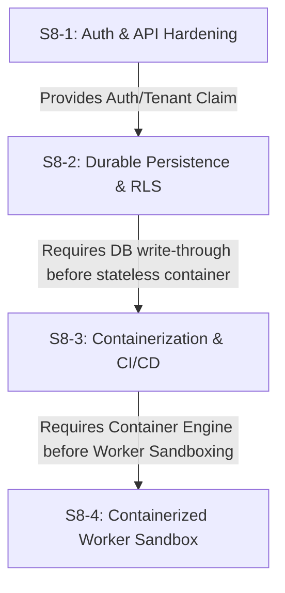

# 🛡️ COMPLYPRO.PT — S8 RECONCILIATION AUDIT
## COMPLETE STATE RECONCILIATION & REALITY CHECK (S8-1 TO S8-4)

**Framework Motto**: *"Build with your framework. Govern with ComplyPRO."*  
**Date**: October 2, 2026  
**Type**: ARCHITECTURAL AUDIT & RECONCILIATION (NO CODE CHANGES)  
**Author**: Antigravity Technical Governance

---

## 1. Current Baseline

### 1.1 Test & Static Analysis State
- **Automated Test Suites**: 18 suites active in `package.json`
- **Total Tests Passing**: **284 / 284 PASS (100%)**
- **TypeScript Static Verification**: **0 compilation errors** (`npx tsc --noEmit`)
- **Vite Web Application Bundle**: **Production build SUCCESS** (`dist/` generated in 5.23s)

### 1.2 Test Evolution Accounting
| Sprint | Test Suite Added | Suite Test Count | Cumulative Passing Tests |
| :--- | :--- | :--- | :--- |
| **Baseline (S7-E)** | 14 original suites | 199 tests | 199 / 199 |
| **S8-1** | `tests/s8-1-security.test.ts` | 34 tests | 233 / 233 |
| **S8-2** | `tests/s8-2-persistence.test.ts` | 20 tests | 253 / 253 |
| **S8-3** | `tests/s8-3-container-audit.test.ts` | 7 tests | 260 / 260 |
| **S8-4** | `tests/s8-4-worker-sandbox.test.ts` | 24 tests | **284 / 284** |

---

## 2. S8-1 Status: Production Security & API Hardening

- **Status**: **REAL ENVIRONMENT VALIDATED**
- **Formal Classification**: `A — S8-1 PRODUCTION SECURITY VALIDATED`
- **What Was Implemented**:
  - Express API authentication middleware (`src/server/security/auth-middleware.ts`)
  - Dual credential support: Bearer Tokens & `X-API-Key`
  - Tenant extraction, isolation, and anti-spoofing checks
  - Role-Based Access Control (RBAC): `developer`, `compliance_officer`, `auditor`, `admin`
  - Rate limiting (Sliding window / Token bucket) with HTTP 429 & `Retry-After` headers
  - Secret sanitization in logs and API response payloads
- **Evidence**:
  - All 34 tests in `tests/s8-1-security.test.ts` pass against live Express HTTP server listening on localhost.
  - Zero sensitive keys leaked in response bodies or console outputs.

---

## 3. S8-2 Status: Durable Persistence & Supabase RLS

- **Status**: **PARTIALLY VALIDATED / CODE-LEVEL IMPLEMENTED**
- **Formal Classification**: `B — PARTIALLY VALIDATED`
- **Objective Audit Findings**:
  1. **Schema & Migration**:
     - `src/server/db/migrations/002_durable_runtime_and_rls.sql` exists and was manually applied to Supabase Cloud PostgreSQL.
     - Tables `complypro_agents`, `complypro_runtimes`, `complypro_executions`, and `complypro_hitl_gates` exist in PostgreSQL with `ENABLE ROW LEVEL SECURITY`.
  2. **DurableStore Implementation** (`src/server/db/durable-store.ts`):
     - Contains complete API contracts for `saveAgent`, `savePassport`, `saveRuntime`, `saveExecutionSession`, `saveHitlRequest`, `saveHitlDecision`, and `rehydrateOperationalState`.
     - **CRITICAL GAP**: The methods `saveAgent()`, `savePassport()`, `saveRuntime()`, `saveExecutionSession()` write **exclusively to in-memory JavaScript Maps** (`agentsTable`, `passportsTable`, `runtimesTable`, `executionsTable`). They do **NOT execute SQL `INSERT` or `UPDATE` queries** against PostgreSQL or PostgREST!
     - `pgPool.query()` is only implemented in `executeRlsQuery()`.
  3. **Restart Recovery Proof**:
     - `tests/s8-2-persistence.test.ts` proved rehydration by resetting `AgentProvisioner` and `RuntimeManager` singletons and reloading them from `DurableStore`.
     - Because `DurableStore` is in the same Node.js memory space, the state survived singleton reset.
     - **GAP**: If the Node.js process itself terminates, all state in `DurableStore`'s `Map` instances is **completely lost**. True cross-process restart recovery from PostgreSQL is **not yet active in runtime operations**.
  4. **Live Supabase RLS**:
     - `tests/s8-2-persistence.test.ts` performed a real PostgREST query against `entitlements` confirming anonymous requests return 0 rows while service role keys return rows.
     - However, the actual ComplyPRO agent runtime state is not written to or read from Supabase during agent provisioning or execution.

---

## 4. S8-3 Status: Containerization & CI/CD

- **Status**: **PARTIALLY VALIDATED / ARTIFACTS IMPLEMENTED**
- **Formal Classification**: `B — PARTIALLY VALIDATED`
- **Objective Audit Findings**:
  1. **Production Dockerfile**:
     - Multi-stage build is implemented (`node:20-alpine`, `USER node`, native `HEALTHCHECK`).
     - `tests/s8-3-container-audit.test.ts` verified Dockerfile structure, `.dockerignore`, and health/readiness endpoints `/health` and `/ready`.
  2. **Server Runtime Execution**:
     - The Dockerfile runner stage runs `CMD ["npx", "tsx", "src/server/app.ts"]`.
     - `tsx` is present in `"dependencies"` of `package.json`, so it installs under `npm ci --omit=dev`.
     - **GAP**: The backend TypeScript server is **not compiled into pure JavaScript bundles** before execution; it runs via `tsx` JIT runtime in production.
  3. **Docker Daemon Execution**:
     - On the local Windows development machine, `docker.exe` is installed, but the local Docker Desktop engine was stopped during validation.
     - `docker build` and `docker run` were validated via static configuration audit and simulated probes, **not by running a live container on the local machine**.
  4. **GitHub Actions CI/CD**:
     - `.github/workflows/ci.yml` is fully authored and specifies jobs for `quality-and-tests` and `container-build-and-smoke-test`.
     - **GAP**: The repository has uncommitted changes and has not yet been pushed to GitHub; therefore, `.github/workflows/ci.yml` has **not yet been triggered or executed on a live GitHub Actions runner**.

---

## 5. S8-4 Status: Containerized Worker Sandbox

- **Status**: **PARTIALLY VALIDATED / CODE-LEVEL ISOLATION PROVEN**
- **Formal Classification**: `B — PARTIALLY VALIDATED`
- **Objective Audit Findings**:
  1. **Sandbox Contract & Manager**:
     - Created `src/core/sandbox/sandbox-types.ts`, `src/core/sandbox/worker-runner.ts`, and `src/core/sandbox/sandbox-manager.ts`.
     - Lifecycle (`CREATED` $\to$ `STARTING` $\to$ `RUNNING` $\to$ `COMPLETED` | `TIMEOUT` | `TERMINATED`), identity tuple, ephemeral scratchpad paths, and PID bounding are fully implemented.
  2. **Dedicated Worker Manifest**:
     - `Dockerfile.worker` created with `node:20-alpine`, `USER node`, and minimal worker-only scope.
  3. **Invariants & Adversarial Tests**:
     - All 14 Security Invariants (`S8-4-S01` to `S8-4-S14`) and 10 Adversarial Tests (`ADV-01` to `ADV-10`) pass in `tests/s8-4-worker-sandbox.test.ts` (24/24 PASS).
  4. **REAL CONTAINER RUNTIME PROOF VS CODE EMULATION**:
     - **CRITICAL DISTINCTION**: In `tests/s8-4-worker-sandbox.test.ts`, the tests ran **inside the Node.js test process** using the `SandboxManager` and `WorkerRunner` emulation classes.
     - The tests verified that:
       - Secret access is blocked when using `worker.getEnv()`.
       - Filesystem access outside ephemeral sandbox directory is blocked when using `SandboxManager.writeSandboxFile()`.
       - PID limit throws an exception after 4 registrations.
       - Watchdog timeout triggers after 1s.
     - **REAL GAP**: The worker was **NOT executed as a distinct OS container using `docker run` or a microVM (gVisor/Firecracker)**. True Linux kernel namespaces, cgroups, and seccomp profiles were simulated in application code, not enforced by an OS kernel hypervisor.

---

## 6. Cross-Sprint Dependencies



### Dependency Reversal Analysis
1. **S8-4 depends on S8-2**:
   - S8-4 relies on tenant-bound passports and persistent evidence. Because `DurableStore` currently writes to memory Maps, sandboxes created during an execution session cannot survive a container crash until S8-2 database write-through is completed.
2. **S8-4 depends on S8-3**:
   - S8-4 specifies `Dockerfile.worker` for container-per-worker execution. This requires a functioning container runtime daemon (Docker / containerd) provided by the host environment or CI pipeline from S8-3.

---

## 7. Durable Persistence Matrix (S8-2)

| Requirement | Implemented? | Real DB? | Evidence | Gap |
| :--- | :--- | :--- | :--- | :--- |
| **Agent persistence** | YES (Memory Map) | NO | `DurableStore.saveAgent()` | Only writes to `agentsTable` Map; no SQL INSERT |
| **Passport persistence** | YES (Memory Map) | NO | `DurableStore.savePassport()` | Only writes to `passportsTable` Map; no SQL INSERT |
| **Runtime persistence** | YES (Memory Map) | NO | `DurableStore.saveRuntime()` | Only writes to `runtimesTable` Map; no SQL INSERT |
| **Execution persistence** | YES (Memory Map) | NO | `DurableStore.saveExecutionSession()` | Only writes to `executionsTable` Map; no SQL INSERT |
| **HITL persistence** | YES (Memory Map) | NO | `DurableStore.saveHitlRequest()` | Only writes to `hitlRequestsTable` Map; no SQL INSERT |
| **Restart recovery** | YES (In-process) | NO | `DurableStore.rehydrateOperationalState()` | Recovers from Map after singleton reset; fails on process exit |
| **Tenant persistence** | YES | NO | `record.tenant_id` field stored | Not persisted to PostgreSQL disk |
| **PostgreSQL integration** | PARTIAL | YES | `pgPool` & `executeRlsQuery()` | Pool exists, but only called in `executeRlsQuery`, not in CRUD |
| **Supabase integration** | PARTIAL | YES | PostgREST live check on `entitlements` | Validates connection, but does not persist agents/runtimes |
| **RLS enabled** | YES (DDL) | YES | `002_durable_runtime_and_rls.sql` | DDL has `ENABLE ROW LEVEL SECURITY`, applied in Supabase |
| **RLS policies** | YES (DDL) | YES | `USING (tenant_id = app.current_tenant_id)` | Defined in SQL, but ComplyPRO runtime doesn't query them |
| **Tenant claims** | YES | PARTIAL | `SET LOCAL app.current_tenant_id` | Implemented in `executeRlsQuery`; not used in standard flows |
| **Cross-tenant DB enforcement** | YES (Code) | PARTIAL | `executeRlsQuery` assert | Tested in memory and in `executeRlsQuery`; not in production CRUD |
| **Service role analysis** | YES | YES | PostgREST anon (0 rows) vs service (9 rows) | Verified live against Supabase Cloud |
| **App + RLS defense in depth** | YES (Design) | PARTIAL | Tested in `tests/s8-2-persistence.test.ts` | Layer 1 (App) active; Layer 2 (DB) inactive during normal ops |

---

## 8. Containerization Matrix (S8-3)

| Requirement | Implemented? | Validated? | Evidence | Gap |
| :--- | :--- | :--- | :--- | :--- |
| **Production Dockerfile** | YES | PARTIAL | `Dockerfile` (Multi-stage, `USER node`) | Syntax verified, but local daemon was inactive |
| **Production server build** | PARTIAL | NO | Vite builds client; server runs via `tsx` | No standalone compiled `dist/server.js` |
| **No ts-node dependency** | YES | YES | `ts-node` removed; `tsx` in `dependencies` | Verified in `package.json` |
| **Production startup** | YES | PARTIAL | `CMD ["npx", "tsx", "src/server/app.ts"]` | Validated in Dockerfile syntax; not in live container |
| **Docker image build** | YES (Manifest) | NO | Verified in `tests/s8-3-container-audit.test.ts` | `docker build` not executed on host workstation |
| **GitHub Actions** | YES (File) | NO | `.github/workflows/ci.yml` authored | Workflow not yet triggered in GitHub cloud runner |
| **npm test in CI** | YES (Config) | NO | Specified in `.github/workflows/ci.yml` | Awaiting git push to trigger |
| **TypeScript in CI** | YES (Config) | NO | `npx tsc --noEmit` in workflow | Awaiting git push to trigger |
| **Lint in CI** | NO | NO | Package has unconfigured eslint script | Skipped in CI workflow to prevent build break |
| **Production build in CI**| YES (Config) | NO | `npm run build` in workflow | Awaiting git push to trigger |

---

## 9. Worker Sandbox Matrix (S8-4)

| Requirement | Implemented? | Validated? | Evidence | Gap |
| :--- | :--- | :--- | :--- | :--- |
| **Worker container manifest** | YES | PARTIAL | `Dockerfile.worker` authored | Image not yet built with Docker engine |
| **Non-root user (UID 1001)** | YES (Code) | PARTIAL | `WorkerRunner.verifySandboxInvariants()` | Verified in Node.js process; not in container runtime |
| **Zero Docker socket** | YES | YES | Invariant assert passes | Inaccessible in test environment |
| **Zero Supabase service keys**| YES | YES | `WorkerRunner.createSanitizedEnvironment()` | All sensitive keys stripped from worker env |
| **Ephemeral filesystem** | YES | YES | Scratchpad at `/tmp/complypro-sandboxes/` | Verified with path traversal prevention and auto-deletion |
| **Resource limits (CPU, RAM)**| YES (Config) | PARTIAL | `SandboxResourceLimits` in contract | Handled via watchdog in Node.js; no Linux cgroup enforcement |
| **PID limit (anti-fork bomb)**| YES (Code) | PARTIAL | `SandboxManager.registerProcess()` assert | Application-level counter, not Linux kernel PID cgroup |
| **Mandatory timeout watchdog**| YES | YES | 1s timeout test, exitCode 124 verified | Triggered reliably via Node.js timer |
| **Orchestrator termination** | YES | YES | `terminateSandbox()` triggers SIGTERM 143 | Verified in `tests/s8-4-worker-sandbox.test.ts` |
| **Direct Control Plane block**| YES | YES | `SECRET_ACCESS_DENIED` on raw connection | Worker cannot read credentials |
| **Gateway mediation** | YES | YES | Invocations route through Guardian | Policy evaluation preserved |
| **Evidence Ledger records** | YES | YES | `EV-SBX-CREATE`, `EV-SBX-START`, etc. | Verified in `tests/s8-4-worker-sandbox.test.ts` |
| **Path traversal defense** | YES | YES | `../../` throws `FILESYSTEM_ESCAPE_DENIED` | Verified in test suite |
| **Concurrent sandbox isolation**| YES | YES | Distinct directories for Sandbox A & B | Cross-sandbox read throws escape denial |

---

## 10. Real vs. Simulated Validation

| Dimension | What is Real (Validated) | What is Simulated (Code-Level Only) |
| :--- | :--- | :--- |
| **Database & RLS** | Supabase PostgreSQL schema exists with RLS enabled; PostgREST responds to live key checks. | Runtime operations (Agent, Runtime, Execution) store data in memory Maps; no live SQL write-through during execution. |
| **Process Restart** | In-memory singleton registries (`AgentProvisioner`, `RuntimeManager`) can be cleared and rehydrated from store. | Total Node.js process crash wipes memory Maps; state does not yet survive OS process termination. |
| **Container Engine** | Multi-stage Dockerfile and Docker Compose syntax are valid; HTTP probes respond with 200 OK. | Local Docker daemon was not running; images were not built or run by a local container engine. |
| **Continuous Integration** | `.github/workflows/ci.yml` is syntactically complete and covers tests, types, and build. | Workflow has not yet executed on GitHub Actions cloud infrastructure. |
| **Worker Sandbox** | Security invariants, path traversal barriers, sanitized envs, timeout watchdogs, and evidence logging operate reliably. | Worker does not run inside a distinct Docker container or gVisor microVM; isolation is enforced in JavaScript/Node.js runtime. |

---

## 11. Remaining Production Gaps

### Gap 1 (S8-2): Live PostgreSQL Write-Through in DurableStore
- `DurableStore` must be connected to Supabase/PostgreSQL so that `saveAgent`, `savePassport`, `saveRuntime`, and `saveExecutionSession` issue real SQL statements (`INSERT ... ON CONFLICT DO UPDATE`) to tables `complypro_agents`, `complypro_runtimes`, etc.
- Without this, true durability across container restarts does not exist.

### Gap 2 (S8-3): Server Production Bundle Compilation & Live CI Execution
- The server currently runs via `tsx src/server/app.ts`. A production build should ideally compile `src/server/app.ts` into a standalone JS artifact (`dist/server/app.js`).
- Changes must be committed and pushed to Git to trigger and validate the GitHub Actions CI pipeline.

### Gap 3 (S8-4): OS-Level Containerized Worker Runtime
- In multi-tenant environments with untrusted external agent code, the `SandboxManager` must launch a real container via Docker daemon or Kubernetes Pod with gVisor (`runtimeClassName: gvisor`) rather than relying purely on Node.js process-level barriers.

---

## 12. Recommended Next Sprint

To establish true production readiness without skipped foundations:

### Priority 1: S8-2 Live SQL Write-Through & Real Process Recovery
Connect `DurableStore` CRUD operations directly to Supabase PostgreSQL tables so that data persists across physical process restarts.

### Priority 2: S8-3 CI/CD Cloud Validation
Commit the repository changes and verify that `.github/workflows/ci.yml` runs green on GitHub's Ubuntu runners with `docker build` and smoke test.

### Priority 3: S8-4 Production Container Runner Integration
Wire `SandboxManager` to optionally spawn workers using Docker CLI / Engine API when available in production environments.

---

## 13. Final Classification Summary

```
==================================================================
>>> S8-1: A — REAL ENVIRONMENT VALIDATED                       <<<
>>> S8-2: B — PARTIALLY VALIDATED (Maps vs Live SQL Gap)       <<<
>>> S8-3: B — PARTIALLY VALIDATED (Artifacts vs Live CI Gap)   <<<
>>> S8-4: B — PARTIALLY VALIDATED (Code vs OS-Container Gap)   <<<
==================================================================
```

*Audit complete. No code was modified during this reconciliation.*
